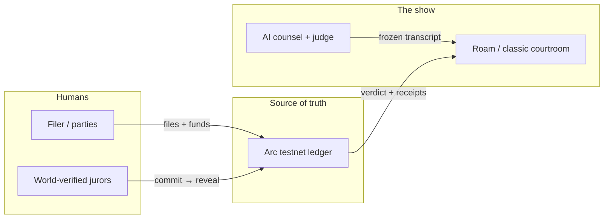
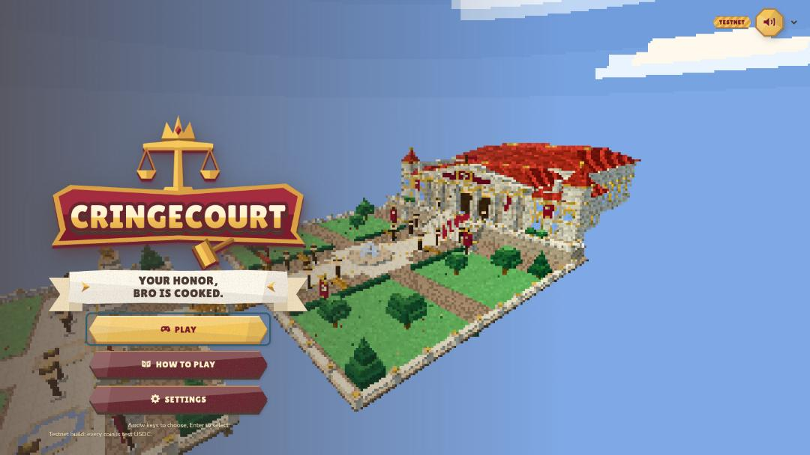
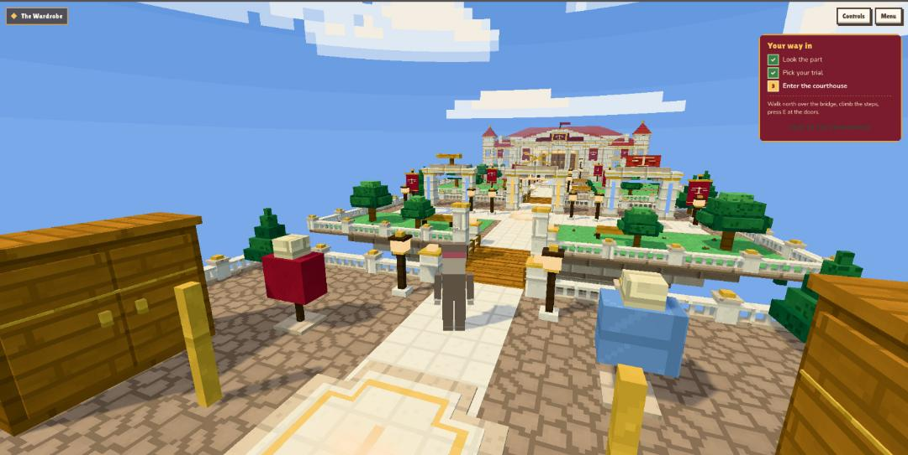
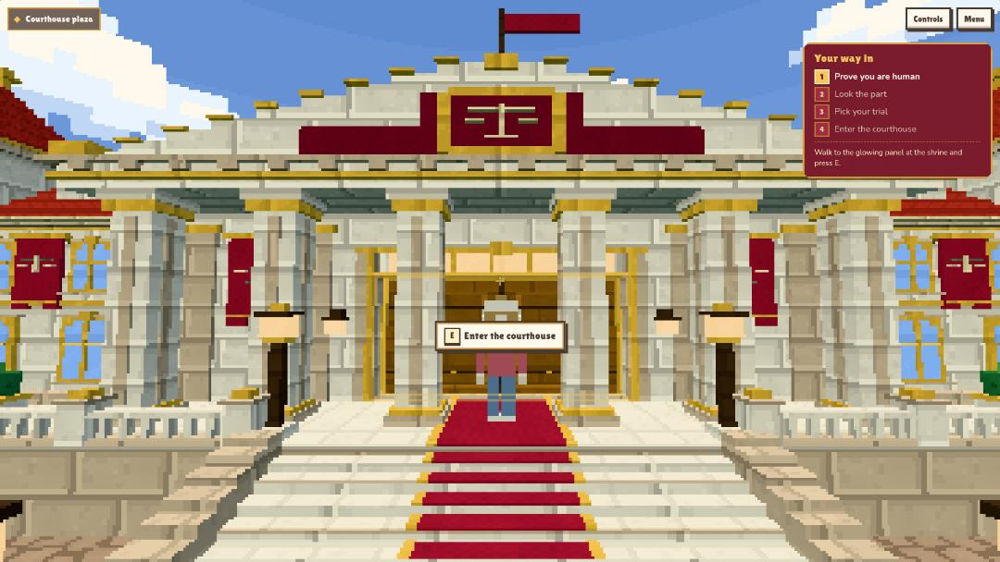
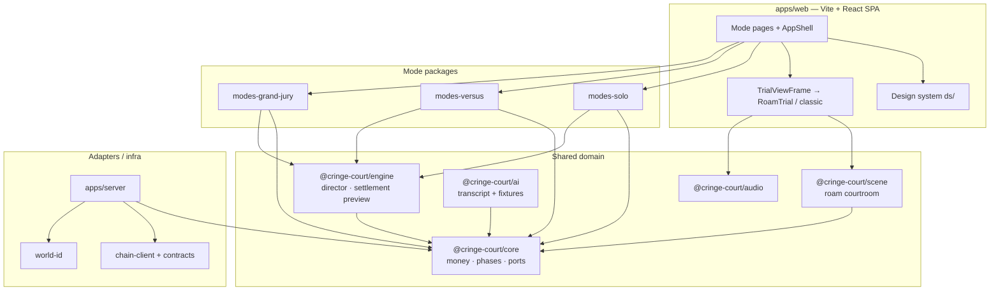
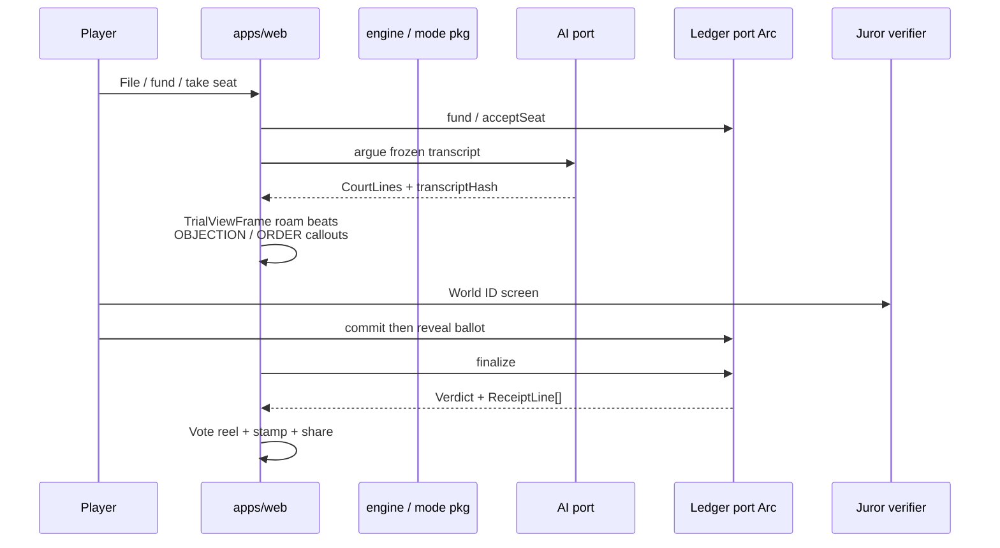
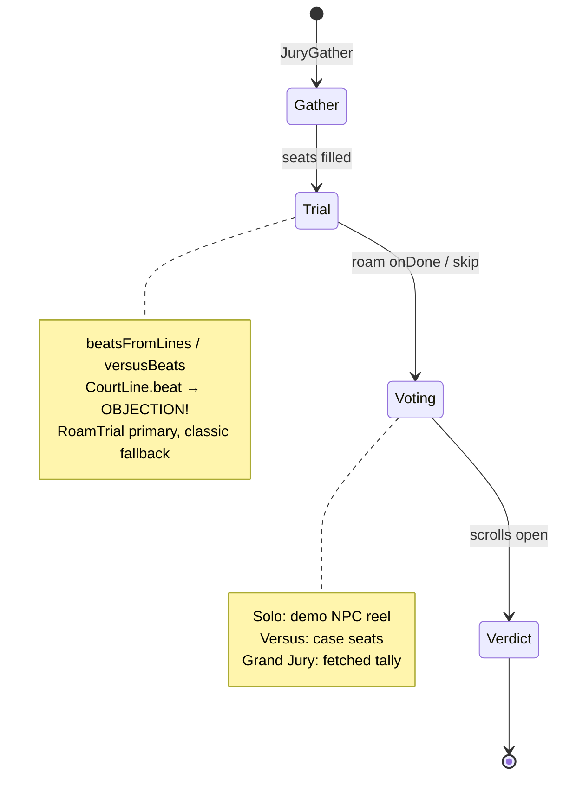

# CringeCourt

A comedy courtroom where **AI lawyers argue** and a **verified human jury**
decides. Testnet only (Arc) — entertainment, not legal advice.

Three modes:

| Mode | Fantasy | Ballot (MVP) |
|---|---|---|
| **Solo** | You + Counsel Chaos vs Miss Ratio (NPC) | GUILTY / NOT COOKED |
| **Versus** | Two people, one AI each | SIDE A / SIDE B |
| **Grand Jury** | Public question, crowd jurors | Case-specific titles |



---

## Look

Voxel town → courthouse → the show. Live captures of the title screen, the
walk up to the doors, and the plaza enter prompt:

| Title | Approach | Courthouse plaza |
|---|---|---|
|  |  |  |

More art review shots live under [`.bbshots/`](.bbshots/). Hero cast turnarounds:
[`packages/scene/assets/roam/heroes/README.md`](packages/scene/assets/roam/heroes/README.md).
Style guide still at [`docs/assets/style-guide.png`](docs/assets/style-guide.png).

---

## Architecture

Monorepo (`npm` workspaces). The web app talks to **ports**; only adapters
touch Arc / World ID / AI SDKs. Domain money and phases live in pure TypeScript
(`@cringe-court/core`).



### Data flow (a case)



### Hearing pipeline (all three modes)

Same ceremony on Solo, Versus, and Grand Jury — not only `/court/walk`:



Deeper write-up: [`docs/ARCHITECTURE.md`](docs/ARCHITECTURE.md) ·
[`docs/ROAM.md`](docs/ROAM.md) · [`docs/ENGINE.md`](docs/ENGINE.md).

---

## Repo layout

```
apps/
  web/                 SPA — shell, modes, ds/, trial/, /gallery
  server/              Backend for live Solo / Arc helpers
packages/
  core/                Types, modes, ports (no DOM, no SDKs)
  engine/              Director, phase rules, settlement maths
  scene/               First-person roam courtroom + hero GLBs
  ai/                  Court transcripts, fixtures, eval scripts
  audio/               Cue recipes (voices, objection, crowd)
  modes-solo|versus|grand-jury/
  chain-client/        Arc client
  world-id/            Juror screening adapter
contracts/             Foundry — escrow, bonds, commit–reveal
cc-art/                Art pipeline → dist the app imports
docs/                  Decisions, economics, design system, …
.bbshots/              Review captures (town, grounds, heroes)
```

Mode registration in the SPA:
[`apps/web/src/modes/README.md`](apps/web/src/modes/README.md).

---

## Run

Requires **Node ≥ 20.19**.

```bash
npm install
npm run dev          # http://localhost:5173  — design gallery at /gallery
npm run check        # tokens, lint, typecheck, tests, production build
```

| Script | What it does |
|---|---|
| `npm run dev` / `build` / `preview` | Vite dev, production build, serve build |
| `npm test` | Vitest (`packages/*` + `apps/web`) |
| `npm run lint` | ESLint (typescript-eslint, react-hooks, jsx-a11y strict) |
| `npm run typecheck` | `tsc -b` over every package |
| `npm run tokens` | regenerate `apps/web/src/ds/tokens.css` (`-- --check` in CI) |
| `npm run art:build` | regenerate `cc-art/` (`cc-art/build-all.mjs`) |
| `npm run server` | API for live Solo / chain helpers |

Secrets stay in ignored `.env*.local` files. Examples only:
`apps/web/.env.example`, `apps/server/.env.example`.

---

## Product docs

| Doc | About |
|---|---|
| [`docs/GAME-MODES.md`](docs/GAME-MODES.md) | Solo / Versus / Grand Jury brief |
| [`docs/DECISIONS.md`](docs/DECISIONS.md) | Locked product + implementation constants |
| [`docs/ECONOMICS.md`](docs/ECONOMICS.md) | Bonds, fees, settlement branches |
| [`docs/DESIGN-SYSTEM.md`](docs/DESIGN-SYSTEM.md) | Tokens, components, motion |
| [`docs/STYLE-GUIDE.md`](docs/STYLE-GUIDE.md) | Visual identity |
| [`docs/BACKEND.md`](docs/BACKEND.md) | Server / Arc integration |
| [`cc-art/dist/CHARACTER-DESIGN-BIBLE.md`](cc-art/dist/CHARACTER-DESIGN-BIBLE.md) | Hero cast look |

---

## Fair play (short)

- **Chain is source of truth** for money and phase; the UI previews, then shows
  what the ledger reports.
- **Transcript is frozen** before voting (`transcriptHash`).
- **Ballot salts never leave the client**; commit is a hash, reveal is choice + salt.
- **World ID** screens jurors; parties are excluded from their own jury.
- Badge in the shell: **TESTNET** — no mainnet ledger types in the ports.
