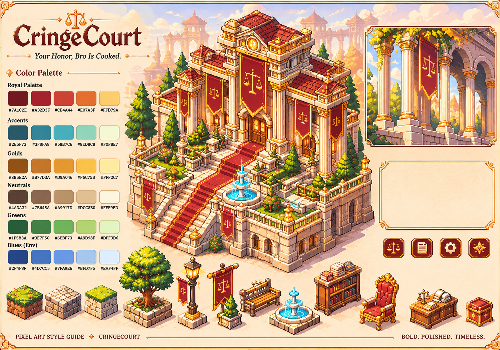
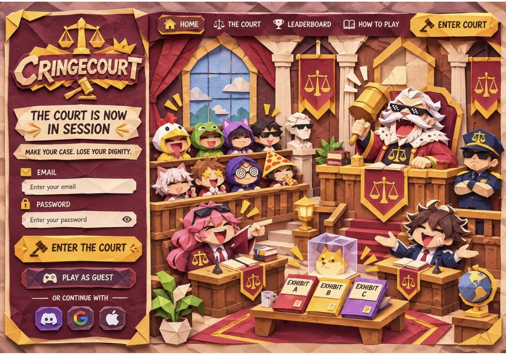

# CringeCourt — Style Guide (canonical)

> **Canonical.** This file and its source image are the visual identity of
> CringeCourt. Where any other document disagrees (notably the old night/neon
> palette in `docs/DESIGN-SYSTEM.md`), this file wins.

Source: `docs/assets/style-guide.png`, "CringeCourt: *Your Honor, Bro Is
Cooked.*" pixel-art style guide (Chayan, 2026-11-03). The printed hex labels in
the image are authoritative; the swatch pixels in the PNG are not sampled.

Code: `apps/web/src/ds/tokens.ts` (palette, roles, contrast pairs) →
`tokens.css` (generated). Live: `/gallery` (switch Parchment / Wood).

---

## 1. Palette (30 swatches)

Each ramp is written dark → light. Token names are `--cc-<family>-<step>`, with
steps 900 / 700 / 500 / 300 / 100 in the order printed in the guide.

| Group (guide) | Token family | 900 | 700 | 500 | 300 | 100 | Role in the identity |
|---|---|---|---|---|---|---|---|
| Royal Palette | `royal` | `#7A1C2E` | `#A32D3F` | `#CE4A44` | `#E07A3F` | `#FFD79A` | Brand maroon: title, banners, primary buttons, red carpet; orange/peach for Side B and danger tints |
| Accents | `teal` | `#2E5F73` | `#3F8FA8` | `#58B7C6` | `#8EDBC8` | `#F0F8E7` | Secondary actions, info, focus ring, Side A; fountain water |
| Golds | `gold` | `#8B5E2A` | `#B77D3A` | `#D9A046` | `#F6C75B` | `#FFF2C7` | Ornate frames, rims, scales, the swear button; `gold-100` is the page parchment |
| Neutrals | `neutral` | `#4A3A32` | `#7B645A` | `#A9917D` | `#DCC8B0` | `#FFF9ED` | Ink, wood, stone; `neutral-100` is the cream card/panel |
| Greens | `green` | `#1F5B3A` | `#3E7F50` | `#6EBF73` | `#A9D98F` | `#DFF3D6` | Success, NOT COOKED; trees and lawns |
| Blues (Env) | `blue` | `#2F4F8F` | `#4D7CC5` | `#7FA9E6` | `#BFD7F5` | `#EAF4FF` | Environment only: sky over the courthouse, distance haze |

## 2. Usage rules

1. **Only these 30 colours.** No other hex, `rgb()` or `hsl()` literal may
   appear in components, pages, the shell or the gallery. Translucency is a
   palette colour with alpha (`alpha()` in `tokens.ts`, or
   `color-mix(in srgb, var(--cc-…) N%, transparent)` in CSS). Enforced by
   `tokens.test.ts`: every role is a palette colour, `tokens.css` contains only
   palette colours, and a source scan rejects raw colours.
2. **Components use semantic roles** (`--cc-color-*`). Palette steps
   (`--cc-gold-500` …) are allowed only where the colour *is* the art: frame
   bands, corner knots, ribbons, the round icon tiles, the hero title.
3. **Parchment is the default surface.** `gold-100` page, `neutral-100`
   cards. Use the **wood** surface (`data-surface="wood"`: `neutral-900` wood,
   `royal-900` velvet panels, gold type) for one deep band per view at most:
   the footer, toasts, a verdict panel, stage overlays.
4. **Maroon leads, gold frames.** Primary actions and big headings are maroon
   (`royal-900`); gold is for rims, rules, ornaments and the swear button.
   **Gold is never body text on cream** (`gold-300` on `gold-100` is 1.42:1):
   when a "gold" label is needed on parchment, use `highlight-shadow`
   (`gold-900`, 5.03:1).
5. **Teal = secondary / info, green = success, blue = environment.** Blue
   never carries meaning in UI chrome; it is sky and distance.
6. **Danger vs. primary:** both are royal. Primary is `royal-900` in a gold rim;
   danger is `royal-700` with a dark rim and is always paired with an icon or
   explicit wording ("Refund everyone", "Slash bond").
7. **Sides:** Side A is teal (`teal-700` / wood `teal-500`), Side B is
   coral-orange (`royal-500` / wood `royal-100`). Solid side badges sit on the
   deeper `secondary` / `danger` roles so their labels reach 4.5:1.

## 3. Semantic roles

| Role | Parchment (default) | Wood |
|---|---|---|
| `canvas` | `#FFF2C7` gold-100 | `#4A3A32` neutral-900 |
| `surface` | `#FFF9ED` neutral-100 | `#7A1C2E` royal-900 |
| `surface-raised` | `#FFF9ED` neutral-100 | `#7A1C2E` royal-900 |
| `surface-sunken` | `#FFF2C7` gold-100 | `#4A3A32` neutral-900 |
| `scrim` | `rgb(74 58 50 / 0.62)` | `rgb(74 58 50 / 0.78)` |
| `text` | `#4A3A32` neutral-900 | `#FFF9ED` neutral-100 |
| `text-muted` | `#7B645A` neutral-700 | `#FFD79A` royal-100 |
| `text-subtle` | `#8B5E2A` gold-900 | `#DCC8B0` neutral-300 |
| `border` | `#DCC8B0` neutral-300 | `#7B645A` neutral-700 |
| `border-strong` | `#8B5E2A` gold-900 | `#A9917D` neutral-500 |
| `frame` | `#D9A046` gold-500 | `#D9A046` gold-500 |
| `frame-light` | `#F6C75B` gold-300 | `#F6C75B` gold-300 |
| `frame-dark` | `#8B5E2A` gold-900 | `#8B5E2A` gold-900 |
| `accent` | `#7A1C2E` royal-900 | `#F6C75B` gold-300 |
| `accent-hover` | `#A32D3F` royal-700 | `#FFD79A` royal-100 |
| `accent-pressed` | `#7A1C2E` royal-900 | `#D9A046` gold-500 |
| `accent-shadow` | `#4A3A32` neutral-900 | `#8B5E2A` gold-900 |
| `accent-text` | `#7A1C2E` royal-900 | `#F6C75B` gold-300 |
| `on-accent` | `#FFF9ED` neutral-100 | `#4A3A32` neutral-900 |
| `secondary` | `#2E5F73` teal-900 | `#8EDBC8` teal-300 |
| `secondary-hover` | `#3F8FA8` teal-700 | `#F0F8E7` teal-100 |
| `secondary-text` | `#2E5F73` teal-900 | `#8EDBC8` teal-300 |
| `highlight` | `#F6C75B` gold-300 | `#F6C75B` gold-300 |
| `on-highlight` | `#7A1C2E` royal-900 | `#7A1C2E` royal-900 |
| `highlight-shadow` | `#8B5E2A` gold-900 | `#8B5E2A` gold-900 |
| `danger` | `#A32D3F` royal-700 | `#A32D3F` royal-700 |
| `danger-hover` | `#7A1C2E` royal-900 | `#7A1C2E` royal-900 |
| `danger-shadow` | `#4A3A32` neutral-900 | `#8B5E2A` gold-900 |
| `danger-text` | `#A32D3F` royal-700 | `#FFD79A` royal-100 |
| `on-danger` | `#FFF9ED` neutral-100 | `#FFF9ED` neutral-100 |
| `danger-surface` | `#FFD79A` royal-100 | `#7A1C2E` royal-900 |
| `success-text` | `#1F5B3A` green-900 | `#A9D98F` green-300 |
| `success-surface` | `#DFF3D6` green-100 | `#1F5B3A` green-900 |
| `warning-text` | `#8B5E2A` gold-900 | `#FFF2C7` gold-100 |
| `warning-surface` | `#FFF9ED` neutral-100 | `#8B5E2A` gold-900 |
| `info-text` | `#2E5F73` teal-900 | `#F0F8E7` teal-100 |
| `info-surface` | `#F0F8E7` teal-100 | `#2E5F73` teal-900 |
| `focus` | `#2E5F73` teal-900 | `#F6C75B` gold-300 |
| `guilty` | `#A32D3F` royal-700 | `#E07A3F` royal-300 |
| `not-cooked` | `#3E7F50` green-700 | `#6EBF73` green-500 |
| `side-a` | `#3F8FA8` teal-700 | `#58B7C6` teal-500 |
| `side-b` | `#CE4A44` royal-500 | `#FFD79A` royal-100 |
| `sky` | `#BFD7F5` blue-300 | `#2F4F8F` blue-900 |
| `sky-light` | `#EAF4FF` blue-100 | `#4D7CC5` blue-700 |
| `disabled-surface` | `#DCC8B0` neutral-300 | `#7B645A` neutral-700 |
| `disabled-text` | `#7B645A` neutral-700 | `#DCC8B0` neutral-300 |

## 4. Approved text / surface pairings (measured)

WCAG 2.1 relative-luminance contrast, computed from the token values by
`apps/web/src/ds/lib/contrast.ts`; every row is a unit test
(`apps/web/src/ds/tokens.test.ts`) on both surfaces. 4.5:1 = body text,
3:1 = large text and UI parts (WCAG 1.4.3 / 1.4.11).

| Use | Text / mark | Surface | Parchment | Wood | Needs |
|---|---|---|---|---|---|
| body text | `text` | `canvas` | `#4A3A32` on `#FFF2C7` **9.67** | `#FFF9ED` on `#4A3A32` **10.31** | 4.5:1 |
| text on panels | `text` | `surface` | `#4A3A32` on `#FFF9ED` **10.31** | `#FFF9ED` on `#7A1C2E` **9.85** | 4.5:1 |
| text on cards | `text` | `surface-raised` | `#4A3A32` on `#FFF9ED` **10.31** | `#FFF9ED` on `#7A1C2E` **9.85** | 4.5:1 |
| text in inputs and wells | `text` | `surface-sunken` | `#4A3A32` on `#FFF2C7` **9.67** | `#FFF9ED` on `#4A3A32` **10.31** | 4.5:1 |
| secondary text | `text-muted` | `canvas` | `#7B645A` on `#FFF2C7` **4.93** | `#FFD79A` on `#4A3A32` **7.95** | 4.5:1 |
| secondary text on panels | `text-muted` | `surface` | `#7B645A` on `#FFF9ED` **5.25** | `#FFD79A` on `#7A1C2E` **7.59** | 4.5:1 |
| secondary text on cards | `text-muted` | `surface-raised` | `#7B645A` on `#FFF9ED` **5.25** | `#FFD79A` on `#7A1C2E` **7.59** | 4.5:1 |
| hints, placeholders | `text-subtle` | `canvas` | `#8B5E2A` on `#FFF2C7` **5.03** | `#DCC8B0` on `#4A3A32` **6.66** | 4.5:1 |
| hints on panels | `text-subtle` | `surface` | `#8B5E2A` on `#FFF9ED` **5.37** | `#DCC8B0` on `#7A1C2E` **6.36** | 4.5:1 |
| placeholders in inputs | `text-subtle` | `surface-sunken` | `#8B5E2A` on `#FFF2C7` **5.03** | `#DCC8B0` on `#4A3A32` **6.66** | 4.5:1 |
| links | `accent-text` | `canvas` | `#7A1C2E` on `#FFF2C7` **9.24** | `#F6C75B` on `#4A3A32` **6.82** | 4.5:1 |
| links on cards | `accent-text` | `surface-raised` | `#7A1C2E` on `#FFF9ED` **9.85** | `#F6C75B` on `#7A1C2E` **6.51** | 4.5:1 |
| primary button label | `on-accent` | `accent` | `#FFF9ED` on `#7A1C2E` **9.85** | `#4A3A32` on `#F6C75B` **6.82** | 4.5:1 |
| primary button hover | `on-accent` | `accent-hover` | `#FFF9ED` on `#A32D3F` **6.67** | `#4A3A32` on `#FFD79A` **7.95** | 4.5:1 |
| primary button pressed | `on-accent` | `accent-pressed` | `#FFF9ED` on `#7A1C2E` **9.85** | `#4A3A32` on `#D9A046` **4.67** | 4.5:1 |
| swear button label | `on-highlight` | `highlight` | `#7A1C2E` on `#F6C75B` **6.51** | `#7A1C2E` on `#F6C75B` **6.51** | 4.5:1 |
| danger button label | `on-danger` | `danger` | `#FFF9ED` on `#A32D3F` **6.67** | `#FFF9ED` on `#A32D3F` **6.67** | 4.5:1 |
| danger button hover | `on-danger` | `danger-hover` | `#FFF9ED` on `#7A1C2E` **9.85** | `#FFF9ED` on `#7A1C2E` **9.85** | 4.5:1 |
| secondary button label | `secondary-text` | `canvas` | `#2E5F73` on `#FFF2C7` **6.26** | `#8EDBC8` on `#4A3A32` **6.75** | 4.5:1 |
| secondary button on cards | `secondary-text` | `surface-raised` | `#2E5F73` on `#FFF9ED` **6.67** | `#8EDBC8` on `#7A1C2E` **6.45** | 4.5:1 |
| error banner | `danger-text` | `danger-surface` | `#A32D3F` on `#FFD79A` **5.14** | `#FFD79A` on `#7A1C2E` **7.59** | 4.5:1 |
| field error | `danger-text` | `canvas` | `#A32D3F` on `#FFF2C7` **6.25** | `#FFD79A` on `#4A3A32` **7.95** | 4.5:1 |
| field error on cards | `danger-text` | `surface-raised` | `#A32D3F` on `#FFF9ED` **6.67** | `#FFD79A` on `#7A1C2E` **7.59** | 4.5:1 |
| success banner | `success-text` | `success-surface` | `#1F5B3A` on `#DFF3D6` **6.85** | `#A9D98F` on `#1F5B3A` **4.97** | 4.5:1 |
| warning banner | `warning-text` | `warning-surface` | `#8B5E2A` on `#FFF9ED` **5.37** | `#FFF2C7` on `#8B5E2A` **5.03** | 4.5:1 |
| info banner | `info-text` | `info-surface` | `#2E5F73` on `#F0F8E7` **6.43** | `#F0F8E7` on `#2E5F73` **6.43** | 4.5:1 |
| focus ring | `focus` | `canvas` | `#2E5F73` on `#FFF2C7` **6.26** | `#F6C75B` on `#4A3A32` **6.82** | 3:1 |
| focus ring on cards | `focus` | `surface-raised` | `#2E5F73` on `#FFF9ED` **6.67** | `#F6C75B` on `#7A1C2E` **6.51** | 3:1 |
| input borders | `border-strong` | `canvas` | `#8B5E2A` on `#FFF2C7` **5.03** | `#A9917D` on `#4A3A32` **3.62** | 3:1 |
| input borders on cards | `border-strong` | `surface-raised` | `#8B5E2A` on `#FFF9ED` **5.37** | `#A9917D` on `#7A1C2E` **3.46** | 3:1 |
| GUILTY marks | `guilty` | `canvas` | `#A32D3F` on `#FFF2C7` **6.25** | `#E07A3F` on `#4A3A32` **3.62** | 3:1 |
| GUILTY marks on cards | `guilty` | `surface-raised` | `#A32D3F` on `#FFF9ED` **6.67** | `#E07A3F` on `#7A1C2E` **3.46** | 3:1 |
| NOT COOKED marks | `not-cooked` | `canvas` | `#3E7F50` on `#FFF2C7` **4.31** | `#6EBF73` on `#4A3A32` **4.82** | 3:1 |
| NOT COOKED marks on cards | `not-cooked` | `surface-raised` | `#3E7F50` on `#FFF9ED` **4.60** | `#6EBF73` on `#7A1C2E` **4.61** | 3:1 |
| Side A marks | `side-a` | `canvas` | `#3F8FA8` on `#FFF2C7` **3.29** | `#58B7C6` on `#4A3A32` **4.64** | 3:1 |
| Side A marks on cards | `side-a` | `surface-raised` | `#3F8FA8` on `#FFF9ED` **3.51** | `#58B7C6` on `#7A1C2E` **4.43** | 3:1 |
| Side B marks | `side-b` | `canvas` | `#CE4A44` on `#FFF2C7` **4.01** | `#FFD79A` on `#4A3A32` **7.95** | 3:1 |
| Side B marks on cards | `side-b` | `surface-raised` | `#CE4A44` on `#FFF9ED` **4.27** | `#FFD79A` on `#7A1C2E` **7.59** | 3:1 |

Component-level pairings that use palette steps directly (checked by hand with the same formula):

| Where | Foreground | Background | Ratio | Needs |
|---|---|---|---|---|
| Round icon button glyph (royal) | `gold-300` `#F6C75B` | `royal-700` `#A32D3F` (lightest point of the face) | 4.41 | 3:1 (UI) |
| Round icon button glyph (royal), face edge | `gold-300` | `royal-900` `#7A1C2E` | 6.51 | 3:1 |
| Round icon button glyph (gold tone) | `royal-900` | `gold-300` | 6.51 | 3:1 |
| Ribbon / speaker plate | `gold-100` `#FFF2C7` | `royal-900` | 9.24 | 4.5:1 |
| TESTNET badge | `royal-900` | `gold-300` (stripes `gold-500` are under a `gold-300` text halo) | 6.51 | 4.5:1 |
| Hero title | `royal-900` | `blue-300` `#BFD7F5` (top of the sky) | 7.01 | 3:1 (large) |
| Hero lede over the sky gradient | `neutral-700` `#7B645A` | `blue-100` `#EAF4FF` (it sits below the 38 % stop) | 4.95 | 4.5:1 |
| Footer type (wood) | `gold-300` / `royal-100` | `neutral-900` | 6.82 / 7.95 | 4.5:1 |

**Pairings to avoid** (fail AA, do not use for text): `gold-300`/`gold-500` on
any cream; `royal-300` (`#E07A3F`) on cream (2.67–2.85); `royal-500` text on
`#DCC8B0`; `teal-500` or lighter on cream; `neutral-700` on `neutral-300`
(3.39); anything on `blue-500`/`blue-700` except `neutral-900`.

What changed to pass AA (pairings, not palette identity): gold labels on cream
→ `highlight-shadow`; the TESTNET badge became maroon on gold; solid Side A/B
badges moved to `secondary` / `danger` backgrounds; Countdown and PhaseStepper
"current" text moved from gold to `gold-900`; wood GUILTY marks use
`royal-300` (3.62) because `royal-500` is 2.41 on wood.

## 5. Art direction

> **Partly superseded by §9 (papercraft, 2026-11-03).** The palette, the red
> carpet, the scale banners and the tone below still hold. The **chrome**
> guidance does not: "pixel art, isometric" for UI, "rounded ornate frames",
> pixel corner knots, round icon tiles and the Fraunces/Pixelify type pairing
> are replaced by cut-and-folded paper (§9). Each superseded bullet is marked
> ~~struck~~ → §9.x.

- ~~**Pixel art, isometric.**~~ → §9.9 (UI and hero art are papercraft; the voxel cast and the 3D courtroom stay until their art pass, §9.12). Scenes are isometric pixel art with crisp edges
  (`image-rendering: pixelated` for sprites; never smooth-scale pixel art).
  Voxel characters from `cc-art` stay the cast.
- **The courthouse.** A cream-stone isometric courthouse with maroon roofs,
  gold trims and finials, columns, lanterns, trees and a fountain; it sits
  under a pale blue sky with peach haze and distant arches.
- **Red carpet.** A maroon (`royal-700`/`royal-900`) carpet with gold edging
  runs up the stairs to the doors: the path into court. Use it as the visual
  metaphor for "file a case".
- **Gold scale banners.** Maroon banners with a gold border and a gold scales
  emblem hang from gold rods. The scales glyph (`<Icon name="scales">`) is the
  brand mark (header, favicon, crest over the hero title).
- ~~**Rounded ornate frames.**~~ → §9.2/§9.3 (chamfered paper sheets on a gold mount with photo-corners). Panels are rounded rectangles with a gold band,
  a dark-gold outer line, a hairline inner rule and small ornaments at the
  corners (`OrnateFrame`, `Card tone="ornate" | "parchment"`).
- ~~**Four round icon buttons.**~~ → §9.7 (folded paper gems). Maroon rounded tiles in a gold rim with a gold
  pixel glyph: **scales, document, gear, star** (`RoundIconButton`,
  `RoundIconLink`, `RoundIconTile`). Hover lightens the glyph; press sinks the
  tile onto its edge.
- ~~**Parchment frame.**~~ → §9.3 (mounted sheet). The empty cream panel with a gold rule and corner
  flourishes (right column of the guide) is the default container for
  documents, receipts, dialogue and verdicts.
- ~~**Typography.**~~ → §9.1 (Lilita One paper display face; Fraunces only for the italic motto; no pixel face). A heavy, soft old-style serif for the title and headings
  (Fraunces, `SOFT 100`), maroon with a gold-and-ink extrusion for the hero
  title; the italic serif motto "*Your Honor, Bro Is Cooked.*" between gold
  rules with diamonds; small-caps serif signature lines ("PIXEL ART STYLE
  GUIDE ◆ CRINGECOURT —— BOLD. POLISHED. TIMELESS."). Pixelify Sans keeps a
  pixel accent on eyebrows, badges, stamps and counters.
- **Ornaments.** Gold diamonds `◆` (`.cc-diamond`) and fading gold rules mark
  section heads, the motto and the footer signature.
- **Tone.** Bold, polished, timeless; warm daylight rather than neon night.

## 6. Interim scene art

> `courthouse.webp` no longer appears in the app (the landing hero is the SVG
> courtroom, §9.9); `colonnade.webp` is unused by the papercraft pages. The
> script and files are kept for the cc-art pipeline's `--check`.

Until dedicated renders exist, `apps/web/scripts/gen-guide-art.py`
(`npm run guide-art -w @cringe-court/web [-- --check]`, needs Pillow) crops two
pieces of the style-guide sheet into `apps/web/src/art/guide/`:

| File | Crop (sheet px) | Used for |
|---|---|---|
| `courthouse.webp` | x 428, y 24, 662×770, edges feathered | home hero |
| `colonnade.webp` | x 1112, y 92, 360×334 | mode-card and mode-page stage backdrop |

These are reference art, not final production assets: they are fixed at the
sheet's resolution (no @2x) and should be replaced by native renders.

## 7. Palette remap for the cc-art renders (PR #20)

Recoloured and regenerated in this change (cheap and verified by eye):
`cc-art/ui-kit.mjs` (60 files in `dist/ui/`), `cc-art/brand-kit.mjs` (wordmark ×3,
share card, case card in `dist/brand/`), `cc-art/fx-kit.mjs`
(cream `#FFF6E4` → `#FFF9ED`, 5 FX PNGs).

**Not regenerated:** the voxel/pixel character, scene, prop and player
generators (`artkit.mjs`, `vox-chars.mjs`, `vox-base.mjs`, `player-vox.mjs`,
`chibi-base.mjs`, `sprite-player.mjs`, `sprite-parts.mjs`, `defendant-vox.mjs`,
`chars-v4-core.mjs`, `judge-v2.mjs`, their `dist/source/` mirrors and the JSON
manifests they emit). They drive ~1,400 committed renders whose byte-for-byte
reproducibility is a PR #20 guarantee; changing their colours is an art pass,
not a token swap. The old values they still contain, and the palette colour
each should become when that pass happens:

| Old (used in character/scene art) | Meaning there | Remap to |
|---|---|---|
| `#140E1A` | night backdrop / panel | `#4A3A32` (wood) or `#7A1C2E` |
| `#2A1636` | portrait backdrop | `#7A1C2E` |
| `#3A2A24` | ink / outline | `#4A3A32` |
| `#3FB8C9` | Side A team colour | `#3F8FA8` (shade `#2E5F73`, light `#8EDBC8`) |
| `#F08A3C` | Side B team colour | `#E07A3F` (shade `#CE4A44`, light `#FFD79A`) |
| `#6B4CA8` | purple hair / cloth | `#2E5F73` (or keep as character colour, see below) |
| `#6E1B2A` | burgundy robe / frames | `#7A1C2E` |
| `#C0392B` | red shirt (juror D) / GUILTY | `#A32D3F` |
| `#FF4FB8` | neon pink accents | `#A32D3F` (glows → `#F6C75B`) |
| `#FFF6E4`, `#FFF8EC` | cream / paper | `#FFF9ED` |

Character skin, hair and clothing colours are character design rather than UI
palette; the art pass should decide per character which of these to remap. The
web app does not depend on those colours (tokens carry the identity), and the
pose cutouts are shown in front of the parchment and colonnade backdrops.

## 8. What this supersedes in `docs/DESIGN-SYSTEM.md`

- §1 *Grounding*: the "neon-noir voxel everywhere" direction and the source
  table of brand-kit / ui-kit / vox-chars colours. **Void.**
- §2 *Tokens*: the Palette row (`night`, `neon`, `purple`, `cream`, `ink`,
  `burgundy`, `red`, `orange` …), the Surfaces row (`night` default +
  `parchment`), the Radius note ("small radii keep the pixel edge") and the
  Elevation row (light-not-shadow, neon glows). Replaced by §1–§3 here.
- §3 *Components*: the Card "neon" tone (now `ornate`), the Toast/Tooltip
  night styling, the Icon count (now 25 glyphs) and the absence of
  `RoundIconButton` / `OrnateFrame`.
- §4 *Accessibility*: the focus-ring colours ("gold on night, plum on
  parchment"): now teal on parchment, gold on wood.

## 9. Papercraft art direction (2026-11-03)

Source: `docs/assets/theme-papercraft.jpg`, Chayan's login/landing reference
("I want this type of theme for the game"). It is **direction only**: nothing
in the app embeds, crops or traces it; every shipped piece is original
CSS/SVG. The 30-swatch palette (§1) stays authoritative: the reference uses
the same maroon / gold / cream family. Four derived paper shades are the only
extra colours, each an sRGB mix of two swatches, emitted as `color-mix()` of
palette variables (`tokens.ts → paperShades`):

| Token | Mix | Used for |
|---|---|---|
| `--cc-paper-maroon-deep` | 62 % `royal-900` + `neutral-900` | PLAY AS GUEST plate, nav lower fold, HUD tags |
| `--cc-paper-maroon-fold` | 50 % `royal-900` + `royal-700` | lit fold of a maroon sheet |
| `--cc-paper-cream-fold` | 50 % `neutral-100` + `gold-100` | lit fold of a cream sheet |
| `--cc-paper-cream-shade` | 45 % `neutral-300` + `gold-100` | kraft board, ribbon tails, fields in shadow |

**The idea.** Everything is cut and folded from card and laid in layers:
faceted low-poly folds, scissor-cut corners, torn and pinked edges, a soft
shadow under each layer, fine grain. Playful meme-court humour, warm and rich.

### 9.1 Type

- **Display:** Lilita One (`--cc-font-display`), uppercase, wide tracking, for
  ribbons, buttons, tabs, stamps, card titles. `--cc-font-pixel` now resolves
  to the same face (token kept so existing code keeps working).
- **Body:** Nunito. **Numbers:** JetBrains Mono (money, time).
- **Serif:** Fraunces italic only for the motto "*Your Honor, Bro Is Cooked.*".

### 9.2 Layers, elevation and grain

- **A sheet = fill + facets + grain + cut outline + shadow.** Fill is a palette
  colour; facets are `--cc-paper-facets-panel | plate | gem` (hard-edged light
  and shade planes, one light from the top-left); grain is `--cc-paper-grain`
  (big sheets also get `--cc-paper-mottle`).
- **Elevation** counts the paper layers below a sheet. Box shadows
  `--cc-paper-1…4` for rectangles; `--cc-paper-drop-1…4` (`filter:
  drop-shadow`) for anything with a cut, torn or zig-zag outline, so the
  shadow follows the cut. Each step is a crisp 1–3 px "card thickness" offset
  plus a soft blur. Use: 1 chips/fields, 2 cards/ribbons/nav, 3 dialogs,
  dialogue box, characters, 4 the login panel and the stage.
- **Layering rule:** never more than four visible layers in one stack; a
  backing sheet (gold or maroon) peeks out 4–6 px down-right, never up-left.
- **Never clip a focusable element.** Outlines (chamfer, torn edge) live on
  pseudo-elements or wrapper layers, so focus rings stay whole.

### 9.3 Cuts, folds and edges

- **Chamfer, not radius.** Corners are trimmed with scissors:
  `--cc-paper-cut-sm | md | lg` (4 / 7 / 12 px), `.cc-cut` helper.
  `border-radius` is reserved for things that are round in life.
- **Torn edge** (`--cc-paper-edge-torn-*` masks): kraft boards, the season
  board, the dialogue box's top. **Pinking-shear zig-zag**
  (`--cc-paper-edge-zigzag-*`): receipts, verdict slips, CTA boards.
- **Folds:** a crease is a 1 px darker line or a hard gradient stop; a fold
  never uses a soft gradient.
- **Mounted sheet** (`OrnateFrame`, `Card tone="ornate|parchment"`): content
  sheet on a gold mount, gold photo-corners (folded triangles) on each corner.

### 9.4 Ribbons (`PaperRibbon`)

Cream band in front with a hand-trimmed outline; swallowtail ends folded
behind it (`--cc-paper-cream-shade`, darker because they face away). Ink text
(`neutral-900`, 4.5:1+). `sparks` adds the gold chevrons of "THE COURT IS NOW IN
SESSION". `tails={false}` for tagline slips. Tones: cream (default), maroon
(gold-100 text), gold (royal-900 text). Ribbons are usually the section heading
(`as="h1|h2"`).

### 9.5 Buttons and fields

- **`PaperButton` / `PaperButtonLink`:** `gold` (primary, royal-900 label on
  gold-300, chunky folded plate with a darker card edge), `maroon` (secondary,
  gold-100 on `maroon-deep`), `ghost`. Icon slot (`iconStart`), sizes sm–xl.
  **Press = paper depress:** the plate drops 2–3 px onto its edge and the shadow
  shrinks (`--cc-ease-press`).
- **`PaperField`:** label row with a leading icon (as on the reference), then a
  hand-trimmed cream strip; password fields get the eye toggle (`revealable`).
  Focus is a double ring (ink inside, surface focus colour outside), ≥3:1 on
  both the cream strip and the maroon panel. Errors: icon + text, `aria-invalid`.

### 9.6 Nav (`PaperNavBar`, `PaperTab`)

A maroon strip folded once along its length, with gold-outlined paper tabs
(HOME / THE COURT / LEADERBOARD / HOW TO PLAY) and the gold ENTER COURT
button at the end. Active tab = filled gold plate, `aria-current="page"`
(`activeFor` keeps "The court" current on mode pages). Under 40 rem tabs fold
down to their icons; the label stays the accessible name.

### 9.7 Tiles (`PaperTile`)

Small folded gems (hexagon or rounded square) with a gold rim and a four-facet
face: the Discord / Google / Apple sign-in tiles and quick links. Icon-only, so
`label` is required. Press sinks the tile.

### 9.8 Logo (`Logo`)

SVG, three layouts: `stacked` (scales crest with crown above the wordmark
plate, gavel under it: login panel), `inline` (nav), `mark` (crest only:
footer, favicon-size). The letters are live text in the display face on a
maroon plate with a gold rim, folded across the middle (lit top / gold
bottom) with a dark card extrusion. All fills are palette variables.

### 9.9 Characters and scenes

- **Hero courtroom** (`apps/web/src/landing/hero/`): hand-built layered SVG,
  nine planes back to front (wall, window/columns/curtains/valance, banners and
  throne, bench + judge + bailiff, jury box, stairs, lawyers + desks, exhibits
  + Shiba, foreground plant/globe/carpet). Every colour is a palette token
  (`Swatch` type), so the scene cannot drift from §1.
- **Characters** (`chibi.tsx`): chibi proportions (head ≈ ½ the figure),
  faceted heads with one shaded cheek fold, spiky card hair with a separate
  fringe, laughing open mouths, eyes squeezed shut or in sunglasses / stars /
  swirls; costume hoods (chicken, frog, cat) and hats (pizza, police cap). The
  judge: white spiky hair and folded beard, sunglasses, maroon robe with a fur
  collar, gold gavel. Gold "ha!" sparks fly off whoever is laughing hardest.
- **Scene rules:** one light from the top-left; every object = lit polygon +
  shade facet; shadows only between layers (`--cc-paper-drop-*`); grain is one
  multiplied overlay for the whole scene, not per object.
- **Never** ship the reference JPG or crops of it.

### 9.10 The landing (`/`)

Kraft board with gold folded corners. Left: the maroon sign-in panel
(`PaperPanel tone="maroon" edge="cut" elevation=4 backing="gold"`): stacked
Logo, ribbon, tagline slip, email, password (eye), ENTER THE COURT (gold),
PLAY AS GUEST (maroon), "or continue with" + Discord/Google/Apple tiles, and a
demo-sign-in note. Right: the nav bar over the courtroom in a gold card mount.
Under 64 rem: one column, nav → courtroom → panel. Auth is a **UI stub**:
demo entry and guest play route to `/court`, social tiles toast "coming soon",
the password is wiped on submit, nothing is sent or stored.

### 9.11 Motion

| Name | Where | How | Reduced motion |
|---|---|---|---|
| paper-unfold | dialogs, panels (`unfold`), `.cc-unfold` | rotateX from the top edge, `--cc-ease-unfold` | none |
| paper-slide-in | toasts, hero layers, lists (`.cc-slide-in`, `--cc-stagger`) | translate + slight rotate, settle | none |
| paper-pop | badges, tags (`.cc-pop`) | scale with overshoot | none |
| paper depress | every paper button/tile/chip | 2–3 px drop + shadow shrink | instant |
| gavel-bang | verdict stamp slam, `.cc-gavel-bang`, the hero judge | jolt + shiver | none |
| sway | hanging banners (`.cc-sway`) | ±1.2° | none |
| parallax | hero layers | pointer (mouse only) and scroll, by depth | off; layers reset |

All durations read `--cc-duration-*` (0 ms under reduced motion), and each
helper also has explicit `animation: none` blocks for both the in-app toggle
(`:root[data-reduced-motion='true']`) and the system setting. Enforced by
`ds/papercraft.test.ts`.

**Motion tokens (polish pass, 2026-11-03).** Every duration, delay and easing in
the app is a token. Never write a literal `ms`/`s`, `ease*`, `linear`,
`cubic-bezier()` or `steps()` in CSS; `ds/motion/motionTokens.test.ts` fails on any.

| Token family | Values | Use |
|---|---|---|
| `--cc-duration-*` | instant 0, fast 120, base 200, slow 320, slower 480, dramatic 720 ms | one-shot transitions and animations |
| `--cc-loop-*` | caret 900, blink 1000, spin 800, shimmer 1400, pulse 1600, nudge 2400, idle 4800, sway 6000 ms | ambient loops (carets, spinner, skeleton, badges, idle sways) |
| `--cc-stagger-*` | tight 60, base 70, loose 120 ms | delay between siblings entering in turn (`calc(var(--_i) * var(--cc-stagger-base))`) |
| `--cc-ease-*` | standard, enter, exit, emphasized, stamp, unfold, press, pixel, **sway** (in-out), **linear**, **blink** `steps(2, jump-none)`, **frame** `steps(1, end)`, **shake** `steps(6, end)` | pick by role, not by curve |

- **Page transitions.** Every route change replays `.cc-page-enter` on `<main>`
  (`usePageEnter`): a fade and a `--cc-space-2` rise over `--cc-duration-slow` with
  `--cc-ease-enter`. The page is not remounted, so no state is lost. The fill mode
  is `backwards`, so no transform lingers to trap `position: fixed` children.
- **State transitions.** Panels unfold, list items slide in staggered, stamps slam
  (`--cc-ease-stamp`), and progress bars move linearly. Loading uses the pixel
  spinner (`--cc-loop-spin`) or skeleton shimmer, and both stop under reduced motion.
- **Reduced motion.** Under `data-reduced-motion='true'` (or the system setting
  with no override), all `--cc-duration-*`, `--cc-loop-*` and `--cc-stagger-*`
  tokens collapse to 0 ms. A global net in `base.css` also forces
  `animation-iteration-count: 1`, zero delays and `scroll-behavior: auto` on
  every element, so third-party CSS stops too. Animations still make one 0 ms
  pass, so `animationend` handlers fire.
- **Roaming courtroom HUD.** Its stylesheet (`packages/scene/src/roam/react/styles.ts`)
  reads the same tokens, with fallbacks, and honours both reduced-motion
  switches. In-world motion such as head-bob, shake and cinematic cuts has its own
  reduced-motion handling, described in `docs/ROAM.md`.

### 9.12 What the mode tracks adopt

Merge `v3/p3c-papercraft` first; then use, from `@/ds` only:

| Need | Use | Notes |
|---|---|---|
| Page / section heading | `PaperRibbon as="h1|h2"` | `sparks` for the big moment |
| Hero band, verdict panel | `PaperPanel tone="maroon" edge="cut" backing="gold"` | re-themes children to wood |
| Content card | `Card` (now paper) or `PaperPanel tone="cream"` | `edge="torn"` for documents |
| Primary / secondary action | `PaperButton variant="gold" | "maroon"` | `ButtonLink` → `PaperButtonLink` |
| Inputs | `PaperField` (or `Field`, now paper-styled) | |
| Trial stage | `TrialStage` (paper mount, tag HUD, paper chips) | CSS only, API unchanged |
| Dialogue | `DialogueBox` | torn cream sheet, maroon name tag |
| Verdict | `Stamp` (pinked cream slip, ink stamp, slam) | always parchment inks |
| Jury / cast faces | `Portrait` (gold octagon mount), `AnonymousPortrait` | |
| Case card / receipts | `OrnateFrame` / `Card tone="parchment"`, `Receipt` | photo-corners, zig-zag |
| Quick links / social | `PaperTile` | |
| Motion | `.cc-unfold`, `.cc-slide-in`, `.cc-pop`, `.cc-gavel-bang` | from `ds/styles/paper.css` |

Do not hand-roll rounded pills, glows or pixel borders; do not add hex/rgb
literals (the source scan fails the build).

**3D / voxel courtroom (`packages/scene`, not changed here).** To sit inside
the paper UI it should read as a paper diorama: flat shading
(`MeshLambertMaterial` with `flatShading: true`, or `MeshToonMaterial` with a
2–3 step gradient map); palette-only albedos (walls `neutral-900`/`gold-900`
planks, maroon `royal-700/900` banners and carpet, cream `neutral-100`
columns, gold `gold-300/500` trim); a faint paper-grain texture (the same
`feTurbulence` grain baked to a 256 px tile, multiplied at ~15 %) on large
planes; one warm key light from the camera's top-left (`gold-100`,
intensity ~1.2) plus hemisphere fill (`gold-100` sky / `neutral-900` ground),
no specular; soft contact shadows (PCFSoft, small radius) and **no fog
colours outside the palette** (`lighting.ts` still uses a few off-palette fog
and mood hexes such as `#1a1320`, `#BDF5FF`, `#FF6B5E`: remap them to
`neutral-900`, `blue-100`, `royal-500` in the scene's own art pass). The mode
tracks' 2D chrome around the canvas is already paper (`TrialStage`).
